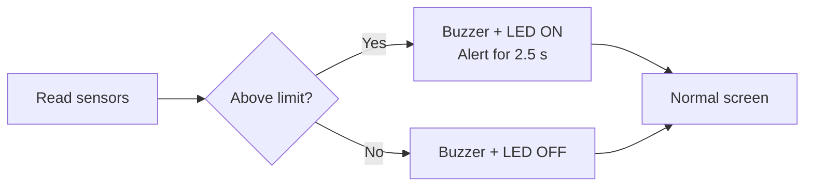

# 🔥 Kitchen Safety – Heat & Gas Monitoring System

A password-protected kitchen safety monitor built on the **LPC2148 (ARM7)** microcontroller.
Measures temperature and gas level, shows them live with a real-time clock, and raises a **buzzer + LED alarm** the moment a limit is crossed.


<p align="center">
  
  <br/>
  <sub><i>System block diagram</i></sub>
</p>


---

## 📑 Table of Contents

- [Overview](#-overview)
- [Hardware Required](#-hardware-required)
- [Pin Connections](#-pin-connections)
- [Software Required](#-software-required)
- [Project Structure](#-project-structure)
- [Build and Flash](#-build-and-flash)
- [How to Use](#-how-to-use)
- [Customising the Defaults](#-customising-the-defaults)
- [Code Organisation](#-code-organisation)
- [Troubleshooting](#-troubleshooting)
- [Limitations and Future Work](#-limitations-and-future-work)
- [Author](#-author)

---

## 🎯 Overview

The system continuously reads an **LM35** temperature sensor and an **MQ-2** gas sensor. The live values and the real-time clock appear on a **16x2 LCD**. If either reading goes above its limit, the buzzer and LED turn on and an alert message is displayed. All settings are protected by a **keypad password** and are edited from an on-screen menu.

### ✨ Features

| Feature | Description |
|---|---|
| 📊 **Live monitoring** | Reads temperature and gas level continuously |
| 🕒 **Real-time clock** | Shows time and date on the LCD using the on-chip RTC |
| 🚨 **Alarm** | Buzzer and LED turn ON when temperature or gas goes above its limit |
| ⚠️ **Alert message** | `ALERT!!` with `TEMP IS HIGH!` or `GAS IS HIGH!` is shown for 2.5 s when a limit is first crossed |
| 🔇 **Alarm mute** | Holding Switch 2 silences the buzzer and LED |
| 📜 **Event history** | The last alarm (time + value) pops up every 10 s for 3 s |
| 🔐 **Password protection** | The settings menu opens only with the correct password |
| 🔒 **Auto-lock** | 3 wrong passwords lock the system for 10 s |
| ⚙️ **Settings menu** | Change the clock, temperature/gas limits and password from the keypad |
| 🎬 **Start-up splash** | Vector ID screen, then a scrolling project title |

### 🔧 Default Values

| Item | Default |
|---|---|
| Temperature limit | 40 °C |
| Gas limit | 300 (scale 0–1023) |
| Password | 1234 |
| Menu time-out | 30 seconds |
| Last-event popup | every 10 s, shown for 3 s |

---

## 🧰 Hardware Required

| # | Component | Purpose |
|---|---|---|
| 1 | LPC2148 ARM7 development board (Vector India Advanced Development Board for ARM7) | Main controller, on-board LCD, buzzer, LEDs, switches, RTC |
| 2 | 16x2 character LCD | Displays everything (on the board) |
| 3 | 4x4 matrix keypad | Enter the password and numbers |
| 4 | MQ-2 gas sensor module | Detects gas / smoke |
| 5 | LM35 temperature sensor | Measures temperature (10 mV per °C) |
| 6 | Buzzer | Audible alarm (on the board) |
| 7 | External 5 V / 3.3 V power supply board | Powers the sensors and the board |
| 8 | Jumper wires, small perfboard | Connections |

### 📷 Hardware Photos

<table align="center">
  <tr>
    <td align="center" width="50%">
      <br/>
      <sub><b>Labeled hardware overview</b></sub>
    </td>
    <td align="center" width="50%">
      <br/>
      <sub><b>Setup with the keypad connected</b></sub>
    </td>
  </tr>
 <table>

The 4x4 keypad plugs into the board through the flat ribbon cable.

---

## 🔌 Pin Connections

These pins come from the `#define` lines at the top of `main.c` and the driver `*_defines.h` files.

| Function | LPC2148 Pin | Notes |
|---|---|---|
| Buzzer | **P0.27** (`BUZZER_PIN`) | Output |
| Alarm LED | **P0.25** (`LED_PIN`) | Output |
| Switch 1 – open settings menu | **P0.1** | Hardware interrupt (EINT0, VIC channel 14) |
| Switch 2 – mute alarm | **P0.3** (`SWITCH2_PIN`) | Input, active-low (pressed = 0) |
| LM35 temperature sensor | **P0.28** (AIN1) | Analog input, ADC channel 1 (`CH1`) |
| MQ-2 gas sensor | **P0.29** (AIN2) | Analog input, ADC channel 2 (`CH2`) |
| LCD data D0–D7 | P0.8 – P0.15 | 8-bit mode |
| LCD RS / RW / EN | P0.16 / P0.17 / P0.18 | Control lines |
| Keypad rows (outputs) | P1.16 – P1.19 | `ROW0`–`ROW3` |
| Keypad columns (inputs) | P1.20 – P1.23 | `COL0`–`COL3` |
| RTC | On-chip | 32.768 kHz clock source |

> [!IMPORTANT]
> If you change a pin in the `#define` lines, change the physical wire as well. Never put two functions on the same pin. `Init_ADC()` sets P0.27–P0.30 to GPIO first and then enables only the analog pins it needs, which is why the buzzer sits on P0.27.

---

## 💻 Software Required

| Tool | Use |
|---|---|
| **Keil µVision (ARM/MDK)** | Write, compile and build the project (the code uses the Keil `__irq` keyword and `<lpc21xx.h>`) |
| **Flash Magic** | Send the `.hex` file to the LPC2148 through the serial (UART) port |
| **USB-to-serial cable** or the board's DB9 port | Connection between PC and board for flashing |

---

## 📁 Project Structure

```
kitchen-safety-system/
├── README.md              <- this file
├── src/
│   ├── main.c             <- the main program
│   ├── ADC.c / ADC.h / ADC_defines.h
│   ├── LM35.c / LM35.h
│   ├── LCD.c / LCD.h / LCD_defines.h
│   ├── KPM.c / KPM.h / KPM_defines.h
│   ├── RTC.c / RTC.h
│   ├── delay.c / delay.h
│   ├── pin_connect_block.c / pin_connect_block.h
│   ├── defines.h
│   └── types.h
└── images/                <- photos used in this README
```

Keep all of these files in the same Keil project as `main.c`:

| File | Provides |
|---|---|
| `types.h` | `u8`, `u16`, `u32`, `s32`, `f32` … type names |
| `defines.h` | Bit-manipulation macros (`SETBIT`, `WRITEBYTE` …) |
| `delay.c/.h` | `delay_us()`, `delay_ms()`, `delay_s()` |
| `pin_connect_block.c/.h` | `cfgportpin()` – PINSEL configuration helper (port 0) |
| `ADC.c/.h`, `ADC_defines.h` | ADC setup (`Init_ADC`) and `Read_ADC()` – 10-bit, 3 MHz ADC clock |
| `LM35.c/.h` | `LM35tC()` – temperature in °C, `LM35tF()` – temperature in °F |
| `LCD.c/.h`, `LCD_defines.h` | LCD commands and printing (`StrLCD`, `U32LCD`, `S32LCD`, `F32LCD`, `BuildcgRAM` …) |
| `KPM.c/.h`, `KPM_defines.h` | Keypad functions (`Init_KPM`, `KeyScan`, `ColScan`, `ReadNum`) |
| `RTC.c/.h` | RTC functions (`RTC_Init`, `GetRTCTimeInfo`, `SetRTCTimeInfo`, `GetRTCDateInfo` …) |

Add every `.c` file to the Keil project.

---

## 🚀 Build and Flash

### Step 1 – Create the Keil project
1. Open **Keil µVision** → **Project → New µVision Project**.
2. Choose a folder, give it a name, and select the device **NXP → LPC2148**.
3. When asked to copy the Startup file, click **Yes**.

### Step 2 – Add the source files
1. Copy `main.c` and all driver `.c` / `.h` files into the project folder.
2. In the Project panel, right-click **Source Group 1 → Add Existing Files to Group** and add `main.c` plus every driver `.c` file.

### Step 3 – Set the clock and create the HEX file
1. **Project → Options for Target → Target**: set the crystal (Xtal) to **12 MHz**.
2. Open the **Output** tab and tick **Create HEX File**.

The code assumes a CPU clock of 60 MHz (12 MHz x 5) and a peripheral clock (PCLK) of **15 MHz**. `T0PR = 14999` gives a 1 ms timer tick, and the ADC clock divider is also derived from PCLK. If your startup configuration uses a different PCLK, adjust these values.

### Step 4 – Build
Press **F7**. Fix any errors until you see **0 Error(s)**. A `.hex` file appears in the output folder.

### Step 5 – Flash the board
1. Connect the board to the PC with a serial cable and power it on.
2. Move the **ISP switch** to the program position and press **RST**.
3. Open **Flash Magic**, choose device **LPC2148**, the correct COM port, baud rate **9600** (or as your lab specifies), and select the `.hex` file.
4. Click **Start** and wait for **Finished**.
5. Move the ISP switch back to the run position and press **RST**.

The Vector ID and project title should now appear on the LCD.

---

## 🕹️ How to Use

### 1. Start-up
The LCD first shows the **Vector ID** (`V25HE11M4`) for 2 seconds, then the project title scrolls across the second line. After that the normal screen appears.

### 2. Normal Screen

```
HH:MM:SS T:xx°C
DD/MM/YYYY S:x
```

- `T:` is the temperature in °C.
- `S:` is the gas status: **0 = safe**, **1 = gas above limit**.

| Gas safe (`S:0`) | Gas above limit (`S:1`) |
|---|---|
<table align="center">
  <tr>
    <th align="center" width="50%">Gas safe (<code>S:0</code>)</th>
    <th align="center" width="50%">Gas above limit (<code>S:1</code>)</th>
  </tr>
  <tr>
    <td align="center"></td>
    <td align="center"></td>
  </tr>
</table>

### 3. Alarm and Alert
When temperature or gas **first** goes above its limit:

1. The buzzer and LED turn **ON**.
2. The LCD shows an alert for **2.5 seconds**.
3. The event (time + value) is saved and the LCD returns to the normal screen.
4. The buzzer and LED stay **ON** until the reading falls back to the limit or below. Holding **Switch 2** silences them while it is pressed.

| Temperature alert | Gas alert |
|---|---|
<table align="center">
  <tr>
    <th align="center" width="50%">Temperature alert</th>
    <th align="center" width="50%">Gas alert</th>
  </tr>
  <tr>
    <td align="center"></td>
    <td align="center"></td>
  </tr>
</table>

**Last-event popup:** every 10 seconds (once at least one event has happened), the last alarm event (time and value) is shown for 3 seconds. The buzzer stays silent during the popup.

```
H:M:S T:45°C      <- last event was temperature
H:M:S S:1         <- last event was gas
```


### 4. Open the Settings Menu
1. Press **Switch 1** (any alarm is silenced when the menu opens).
2. Type the password on the keypad (digits appear as `*`).
3. Press any non-digit key (for example `:`) to confirm. Press `C` to delete the last digit.

| Password entry | Wrong password | Three wrong tries |
|---|---|---|
|  |  |  |
| Digits appear as `*` | `Access Denied` and a short beep | `System Locked` for 10 s with a `Wait:` countdown, then the password is asked again |

**Keypad layout**

```
 7   8   9   /
 4   5   6   *
 1   2   3   -
 C   0   :   +
```

### 5. Settings Menu

```
1.RTC 2.SETPT30     <- number = seconds left to choose
3.PASS 4.EXIT
```

| Settings menu | RTC menu |
|---|---|
|  |  |
| Choose 1 to 4 | Set hour, minute, second, date, month, year |

The menu closes by itself after **30 seconds** without a key press.

| Key | Option | What it does |
|---|---|---|
| `1` | **RTC** | Set the clock and date (see RTC menu) |
| `2` | **SETPT** | `1.TEMP` – set the temperature limit (0–200 °C), `2.GAS` – set the gas limit (0–1023) |
| `3` | **PASS** | Change the password: enter the current password, then the new one, then confirm it |
| `4` | **EXIT** | Return to the normal screen |


### 6. RTC Menu

```
1.H 2.M 3.S 4.D
5.M 6.Y 7.E
```

| Key | Sets | Allowed range |
|---|---|---|
| `1` | Hour | 0 – 23 |
| `2` | Minute | 0 – 59 |
| `3` | Second | 0 – 59 |
| `4` | Date | 1 – 31 |
| `5` | Month | 1 – 12 |
| `6` | Year | 2000 – 2099 |
| `7` | Exit | Back to the previous menu |

Type the number and press a non-digit key (for example `:`) to save. Wrong values show `Invalid! Retry`, and a successful change shows `Saved!`.

---

## 🛠️ Customising the Defaults

Open `main.c` and edit the `#define` lines at the top:

```c
#define TEMP_LIMIT        40     // alarm above this temperature (°C)
#define GAS_LIMIT         300    // alarm above this gas reading (0-1023)
#define DEFAULT_PASSWORD  1234   // starting password
#define MENU_WAIT_TIME    30000  // menu time-out in milliseconds
#define POPUP_EVERY       10000  // last-event popup interval (ms)
#define POPUP_FOR         3000   // last-event popup duration (ms)
#define SPLASH_HOLD_MS    2000   // Vector ID screen hold time (ms)

#define BUZZER_PIN        27     // P0.27
#define LED_PIN           25     // P0.25
#define SWITCH2_PIN       3      // P0.3
```

The start-up time and date are set in `main()`:

```c
SetRTCTimeInfo(9, 37, 0);       // hour, minute, second
SetRTCDateInfo(24, 9, 2026);    // date, month, year
```

Rebuild and flash again after any change. The alert duration is the `delay_ms(2500)` line inside `check_for_danger()`.

---

## 🧩 Code Organisation

`main.c` is split into numbered sections, so you can read it top to bottom:

| Section | Content |
|---|---|
| 1 | Settings (`#define`) |
| 2–3 | Event type and shared variables |
| 4 | 1 ms software clock using Timer 0 |
| 5 | Buzzer, LED and Switch 2 |
| 6 | Switch 1 interrupt (opens the menu) |
| 7–8 | Gas sensor and temperature display helper |
| 9 | Start-up splash screens |
| 10 | Saving and showing the last alarm event |
| 11 | `check_for_danger()` – compares readings with limits and shows the alert |
| 12 | Normal screen |
| 13 | Password, number entry, RTC, set-point and password menus, lock-out |
| 14 | `main()` – the main loop |


**Main loop in short:** check for the Switch 1 flag → read LM35 and MQ-2 → `check_for_danger()` → either run the last-event popup, or follow the danger flags for the buzzer/LED (with Switch 2 mute) and draw the normal screen.

---

## 🩺 Troubleshooting

| Problem | Likely cause and fix |
|---|---|
| LCD is blank | Adjust the contrast potentiometer near the LCD; check the LCD data wires (P0.8–P0.15) and control lines (P0.16–P0.18) |
| Temperature always shows a wrong or very high value | Check the LM35 wiring (5 V, GND, output to P0.28) and the ADC conversion in `LM35.c` |
| Gas alert always on | Let the MQ-2 warm up for a minute or two; adjust the sensor's on-board potentiometer or raise `GAS_LIMIT` |
| Keypad gives wrong keys | Check the ribbon cable orientation and the key table in `KPM.c` |
| Time goes back to 09:37:00 after every reset | `main()` calls `SetRTCTimeInfo()` / `SetRTCDateInfo()` at start-up. Remove or comment those two lines to keep the running clock (needs the RTC battery) |
| Cannot flash | Check COM port, baud rate and that the ISP switch is in program mode |
| Menu never opens | Check the Switch 1 wire on P0.1 and that `setup_switch1()` runs |
| Buzzer silent | Check the buzzer pin wire (P0.27); make sure Switch 2 (mute) is not being held |

---

## 🔭 Limitations and Future Work

**Limitations**

- The password, temperature limit and gas limit are stored in RAM only. They return to the defaults after a power cycle.
- The RTC is re-initialised with a fixed time and date at every start-up (see Troubleshooting).
- While the 2.5-second alert or a delay screen is showing, the sensors are not read.
- Delays are software loops, so their timing is approximate.
- The keypad password is numeric only.
- Switch 2 mutes only while it is held down; it does not latch the mute.

**Possible improvements**

- [ ] Store settings in flash / EEPROM
- [ ] Keep the RTC running across resets (set the time only once)
- [ ] Use a hardware timer instead of software delays
- [ ] Add SMS or app notifications
- [ ] Add a relay to switch off a gas valve

---

## 👤 Author

**MOHAMMAD MUNIYA**
Vector ID: `V25HE11M4`
